# 🍔 Orderly — Patties Burger Direct (Case de Engenharia Fullstack)

[](https://github.com/GabrielVSL/Orderly/actions/workflows/ci.yml)
[](https://orderly-online.vercel.app)
[](https://orderly-api-560m.onrender.com/health)
[](https://neon.tech)

Uma plataforma digital completa de pedidos rápidos (*Direct-to-Consumer*) conceituada para o **Patties Burger**, a icônica hamburgueria artesanal de smash burgers do Brasil. 

Construído com arquitetura desacoplada, o projeto resolve desafios reais de e-commerce: **isolamento de carrinho por sessão multiusuário**, **transações atômicas de checkout (ACID)**, **motor de cupons**, **rastreamento de pedidos em tempo real (Food Tracker)** e **100% de cobertura de testes de integração no backend**.

---

## 🎯 O Desafio de Negócio & Storytelling

Marcas gastronômicas de alta demanda no Instagram sofrem com dois gargalos:
1. **Perda de conversão em canais manuais:** Atendimento via direct e WhatsApp é lento e propenso a erros operacionais.
2. **Dependência de intermediários:** Taxas de até 27% em marketplaces de delivery reduzem a margem de lucro.

**A Solução Construída:**  
O **Patties Burger Direct** oferece um canal próprio ultraveloz no navegador: o cliente escolhe os produtos em um cardápio interativo (com busca em tempo real e abas por categoria), aplica cupons de desconto, fecha o pedido com PIX Copia e Cola instantâneo e acompanha cada etapa da preparação do burger (*Na Chapa ➔ Embalando ➔ Saiu para Entrega ➔ Entregue*) em tempo real.

---

## 🛠️ Tech Stack & Arquitetura

```mermaid
flowchart LR
    subgraph Client["Frontend (React + Vite)"]
        UI["React 19 + Tailwind CSS"]
        Motion["Framer Motion (Micro-interações)"]
        State["Context API (Cart) + Custom Hooks"]
        ClientAPI["Axios + Session Interceptor (UUID)"]
    end

    subgraph Server["Backend (Node.js + Express)"]
        Middleware["Middlewares (Session & Validação)"]
        Controllers["Controllers (Product, Cart, Order)"]
        Services["Services (Lógica de Negócio & Transações)"]
        ORM["Sequelize ORM"]
    end

    subgraph Data["Armazenamento Híbrido"]
        Postgres[("Neon PostgreSQL (Nuvem / Produção)")]
        SQLite[("SQLite (Testes Locais & CI/CD)")]
    end

    Client --> Server
    Server --> Data
```



* **Frontend:** React, Vite, React Router, Tailwind CSS, Framer Motion, `@heroicons/react`, `react-hot-toast`, `react-confetti`.
* **Backend:** Node.js, Express, Sequelize ORM, PostgreSQL (`pg`), SQLite (`sqlite3`).
* **Testes & Qualidade:** Jest, Supertest (16 testes de integração cobrindo catálogo, filtros, carrinho e pedidos).
* **CI/CD & Deploy:** GitHub Actions (testes + build automáticos), Vercel (Frontend), Render (API) e Neon (Postgres).

---

## 💡 Decisões de Engenharia & Boas Práticas

1. **Isolamento de Sessão Multiusuário (`x-session-id`):**  
   Ao abrir o site, um UUID seguro é gerado e armazenado no `localStorage`. O interceptor do Axios injeta o cabeçalho `x-session-id` em todas as requisições. O backend isola os carrinhos por sessão, impedindo que visitantes concorrentes vejam ou limpem o carrinho uns dos outros.

2. **Checkout Transacional com Snapshot Pattern (ACID):**  
   A finalização do pedido roda dentro de uma **transação atômica** (`sequelize.transaction`). Os itens são gravados em `OrderItems` congelando o preço e o nome do produto no momento da compra (*Snapshot Pattern*). Se qualquer etapa falhar, o rollback automático preserva a integridade.

3. **Open-Closed Principle (OCP) com `brandConfig.js`:**  
   Cores, slogans, categorias, metas de frete grátis e cupons de desconto ficam encapsulados em módulos de configuração. É possível mudar a identidade visual ou regras comerciais sem alterar a lógica interna dos componentes.

4. **Princípio da Responsabilidade Única (SRP):**  
   - **Controllers:** Apenas recebem a requisição HTTP e formatam a resposta.
   - **Services:** Concentram 100% das regras de negócio, cálculos matemáticos e persistência.
   - **Middlewares:** Isolam validações de dados de entrada e injeção de sessão.

---

## 🚀 Como Rodar o Projeto Localmente

### 1. Pré-requisitos
* Node.js 18+ instalado.
* Git.

### 2. Clonar o Repositório
```bash
git clone https://github.com/GabrielVSL/Orderly.git
cd Orderly
```

### 3. Rodar o Backend (API REST)
```bash
cd backend
npm install
node src/seeders/seed.js   # Popula o banco com os 20 itens do cardápio Patties
npm run dev                # Inicia o servidor em http://localhost:3001
```

### 4. Rodar o Frontend (React Client)
Em outro terminal:
```bash
cd frontend
npm install
npm run dev                # Inicia a aplicação em http://localhost:5173
```

---

## 🧪 Suíte de Testes Automatizados (Backend)

O backend conta com uma suíte de testes de integração com **Jest** e **Supertest** que valida toda a API em memória sem necessidade de banco externo:

```bash
cd backend
npm test
```

**Cenários Cobertos pelos Testes:**
* ✅ Health check (`GET /health`)
* ✅ Catálogo de produtos, busca textual e filtro por categorias
* ✅ Adição ao carrinho e validação de limite de até 10 unidades
* ✅ **Isolamento de carrinho entre múltiplas sessões concorrentes**
* ✅ Validação matemática de cupons de desconto (`PATTIES10`, `PRIMEIRACOMPRA`)
* ✅ Rejeição de checkouts com dados inválidos
* ✅ Criação atômica de pedido, geração de código `#PAT-XXXX` e limpeza de carrinho
* ✅ Rastreamento de pedido e atualização de etapas do Food Tracker

---

## 📖 Endpoints da API

<details>
<summary>Clique para expandir a documentação detalhada das rotas</summary>

### 🍔 Produtos (`/api/products`)
* `GET /api/products` — Retorna produtos (aceita query params: `?category=burgers`, `?search=bacon`, `?maxPrice=50`).
* `GET /api/products/:id` — Retorna um produto específico pelo ID.

### 🛒 Carrinho (`/api/cart`) — *Requer header `x-session-id`*
* `GET /api/cart` — Retorna itens da sacola da sessão atual.
* `POST /api/cart` — Adiciona produto `{ productId, quantity }`.
* `PUT /api/cart/:id` — Altera quantidade `{ quantity: 1..10 }`.
* `DELETE /api/cart/:id` — Remove item da sacola.

### 🧾 Pedidos (`/api/orders`) — *Requer header `x-session-id`*
* `POST /api/orders/validate-coupon` — Valida cupom `{ code, subtotal }`.
* `POST /api/orders` — Cria o pedido dentro de transação atômica.
* `GET /api/orders` — Lista histórico de pedidos da sessão.
* `GET /api/orders/:orderNumber` — Detalhes e status do pedido para o rastreador.
* `PATCH /api/orders/:orderNumber/status` — Atualiza status da etapa (`received`, `preparing`, `packing`, `delivering`, `delivered`).

</details>

---

## 🛡️ Licença
Distribuído sob a licença MIT. Projeto de estudo conceitual e portfólio de engenharia de software — Homenagem não oficial ao Patties Burger.
